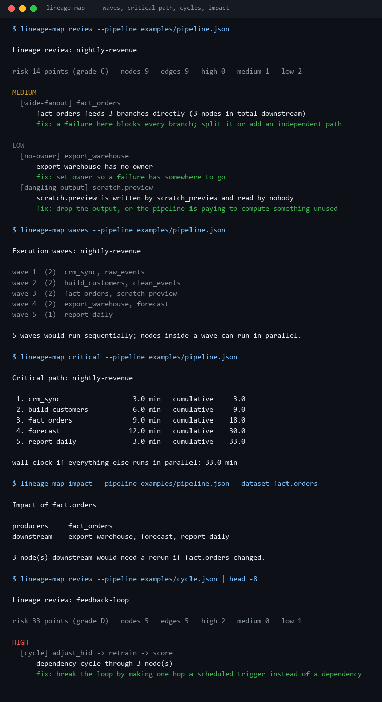
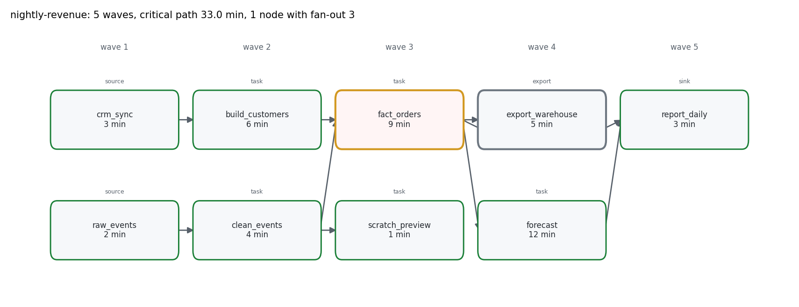
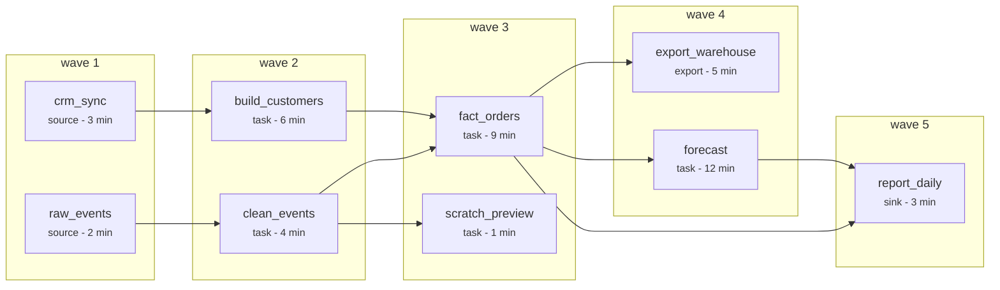
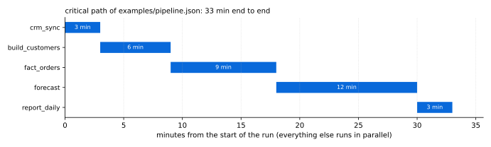

# Pipeline-Lineage-Mapper

**Reads a pipeline definition and answers the four questions every data team argues about: what
can run in parallel, what is the critical path, where is the cycle, and what breaks if this
dataset changes?**



All figures in this README come from `scripts/render_assets.py` running this repository's code on
the two example pipelines.

---

## Table of contents

- [Why this exists](#why-this-exists)
- [The map, drawn from the file](#the-map-drawn-from-the-file)
- [Execution waves](#execution-waves)
- [The critical path](#the-critical-path)
- [Cycles: what they cost](#cycles-what-they-cost)
- [Impact analysis](#impact-analysis)
- [The rules](#the-rules)
- [Install and run](#install-and-run)
- [Commands](#commands)
- [The pipeline file format](#the-pipeline-file-format)
- [Design notes and limits](#design-notes-and-limits)
- [Tests](#tests)
- [License](#license)

---

## Why this exists

A pipeline definition knows things nobody wrote down:

1. **Parallelism.** Nine nodes and nine edges sound serial. They are not: five waves means five
   sequential steps with two tasks running inside each of them.
2. **The critical path.** One 12-minute node and four 3-minute nodes both feel "medium". Only the
   path sum tells you the run takes 33 minutes no matter how many workers you add.
3. **Cycles.** A back-edge looks harmless in code and makes the whole schedule impossible.
4. **Blast radius.** "If this table is wrong, what do we rerun?" is a graph question, and the
   answer is usually bigger than the person asking expects.

This tool reads a JSON description of nodes and edges - no orchestrator, no database, no DAG
scheduler - and prints the answers.

## The map, drawn from the file





`lineage-map graph` emits exactly that block, so a review comment can carry the picture. The PNG
above is the same graph with the worst finding per node encoded as a border colour.

## Execution waves

```
wave 1  (2)  crm_sync, raw_events
wave 2  (2)  build_customers, clean_events
wave 3  (2)  fact_orders, scratch_preview
wave 4  (2)  export_warehouse, forecast
wave 5  (1)  report_daily
```

Waves are the **longest-path depth** of each node, not its order in the file. `fact_orders` waits
for both `clean_events` and `build_customers`, so it can never be in wave 2 even though it is
listed third. Nine nodes in five waves means the theoretical best case is five sequential steps -
adding workers beyond two buys nothing.

## The critical path

```
 1. crm_sync                  3.0 min   cumulative     3.0
 2. build_customers           6.0 min   cumulative     9.0
 3. fact_orders               9.0 min   cumulative    18.0
 4. forecast                 12.0 min   cumulative    30.0
 5. report_daily              3.0 min   cumulative    33.0
```



The interesting part is the choice of branch at wave 2. `raw_events → clean_events` is 6 minutes
of prefix; `crm_sync → build_customers` is 9. The path through CRM wins, so **`build_customers`
is on the critical path and `clean_events` is not** - even though `clean_events` feeds more nodes.
Optimising by "most downstream nodes" would target the wrong branch; optimising by path sum picks
the right one.

At 33 minutes end to end, the only nodes worth making faster are `forecast` (12 min, 36% of the
total) and `fact_orders` (9 min). Shaving `scratch_preview` from 1 minute to zero changes nothing,
because it is not on the path at all.

## Cycles: what they cost

`examples/cycle.json` is the same tool applied to a feedback loop:

```
Lineage review: feedback-loop
==============================================================================
risk 33 points (grade D)   nodes 5   edges 5   high 2   medium 0   low 1

HIGH
  [cycle] adjust_bid -> retrain -> score
      dependency cycle through 3 node(s)
      fix: break the loop by making one hop a scheduled trigger instead of a dependency
  [duplicate-writer] ml.scores
      ml.scores is written by 2 nodes: retrain, score
```

A cycle is reported as the cycle itself, rotated to start at its alphabetically first node, so the
same loop never appears three times. Nodes inside a cycle are excluded from waves and from the
critical path - the schedule view says "there is no valid schedule for these three", which is the
truth - while nodes downstream of a cycle still get placed.

The second finding is the one that actually caused the loop: two nodes both write `ml.scores`.
Duplicate writers are how lineage quietly becomes a lie, and they are invisible in a diagram.

## Impact analysis

```
$ lineage-map impact --pipeline examples/pipeline.json --dataset fact.orders
producers     fact_orders
downstream    export_warehouse, forecast, report_daily

3 node(s) downstream would need a rerun if fact.orders changed.
```

The same question for `stg.events` returns five nodes, including `scratch_preview`, which nobody
remembers exists. That is the point: the answer comes from the graph, not from memory.

## The rules

| Severity | Code | Trigger |
| --- | --- | --- |
| 🟠 high | `cycle` | a dependency cycle (one finding per cycle) |
| 🟠 high | `duplicate-writer` | two or more nodes write the same dataset |
| 🟡 medium | `missing-upstream` | a non-source node reads a dataset no node writes |
| 🟡 medium | `wide-fanout` | a node feeds ≥ 3 branches directly |
| 🟡 medium | `isolated-node` | a node with no parents and no children |
| ⚪ low | `no-owner` | a node has no owner |
| ⚪ low | `dangling-output` | a dataset written and read by nobody |

Grades: `A` = 0, `B` ≤ 10, `C` ≤ 30, `D` ≤ 60, `F` > 60 points (15 / 8 / 3 per finding).
`nightly-revenue` scores **14 points (grade C)**: one `wide-fanout` on `fact_orders`, a
`no-owner` on `export_warehouse`, and one `dangling-output` on `scratch.preview`.

`dangling-output` deliberately ignores nodes whose kind is `sink` or `export`: those are supposed
to be terminal. `scratch.preview` is neither, so it is flagged - a preview table that nothing
reads is a compute bill with no reader.

## Install and run

Standard library only.

```bash
python -m pip install -e ".[dev]"
lineage-map review --pipeline examples/pipeline.json
```

From a checkout without installing:

```bash
PYTHONPATH=src python -m pipeline_lineage_mapper review --pipeline examples/pipeline.json
```

## Commands

| Command | What it answers |
| --- | --- |
| `review --pipeline F [--format text\|markdown\|json] [--fail-on high]` | is this pipeline sound? |
| `graph --pipeline F` | Mermaid flowchart grouped by wave |
| `waves --pipeline F` | what can run in parallel |
| `critical --pipeline F` | the longest duration path and the wall clock floor |
| `impact --pipeline F --dataset D` | what a change to `D` invalidates |
| `node --pipeline F --id N` | one node: reads, writes, upstream, downstream |

Exit codes: `0` clean at `--fail-on`, `1` findings at or above it, `2` bad input or unknown node.

## The pipeline file format

```json
{
  "name": "nightly-revenue",
  "nodes": [
    { "id": "raw_events", "kind": "source", "owner": "data-platform",
      "writes": ["raw.events"], "minutes": 2 },
    { "id": "fact_orders", "owner": "data-platform",
      "reads": ["stg.events", "dim.customers"], "writes": ["fact.orders"], "minutes": 9 }
  ],
  "edges": [["clean_events", "fact_orders"]]
}
```

- **`edges` are dependency edges**, `[from, to]` meaning `to` runs after `from`. Datasets are
  descriptive metadata for lineage and impact, not a second source of edges - the file says
  explicitly what depends on what, so a typo in `reads` cannot silently change the schedule.
- `kind` is `source`, `task`, `sink`, or `export`. `sink`/`export` suppress `dangling-output`.
- `minutes` is wall-clock duration and only affects the critical path; it can be omitted.
- Duplicate edges collapse, self-edges are rejected, and edges to unknown nodes fail loudly with
  both node names.

## Design notes and limits

- **One definition, no inference.** Lineage is *declared*, not discovered by parsing SQL. That
  means it cannot be wrong about the schedule, and it can be wrong about reality if the file is
  stale - which `dangling-output` and `missing-upstream` tend to expose.
- **Cycles are reported, not resolved.** The tool will not guess which edge is "really" a trigger.
- **Critical path assumes unlimited workers.** It is the floor, not a prediction: real schedulers
  have slot limits, retries and skew. It is still the right number for "which node should I
  optimise".
- **Waves ignore resource pools.** Two nodes in wave 3 might need the same exclusive cluster; the
  graph does not know about that.
- **Deterministic everywhere.** Ties break alphabetically, so two runs on the same file produce
  byte-identical output - which is what makes the committed screenshots reproducible.

## Tests

```bash
PYTHONPATH=src python -m pytest -q     # 57 passed
python -m ruff check .                 # All checks passed!
```

57 tests cover parsing and every rejection path, topological order and depth on a diamond,
cycle detection (reported once, rotated to a stable start), wave exclusion for cyclic nodes, the
critical path choosing the slow branch, ancestors/descendants, impact analysis, every rule's
trigger and non-trigger, and every CLI command and exit code.

## License

MIT. See [LICENSE](LICENSE).

---

<sub>Screenshots and charts are generated by `scripts/render_assets.py` from this repository's own
output. No third-party images are used.</sub>
